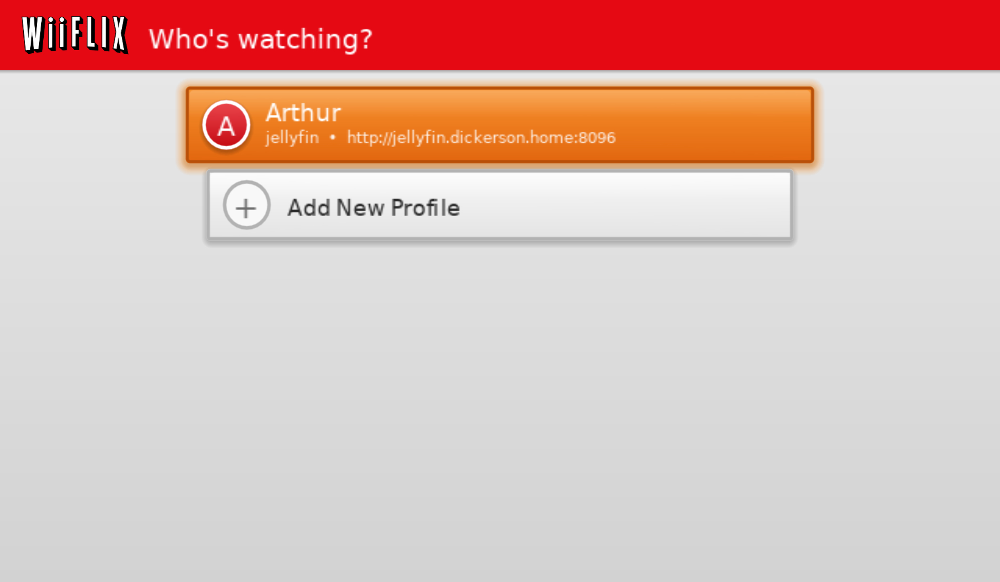
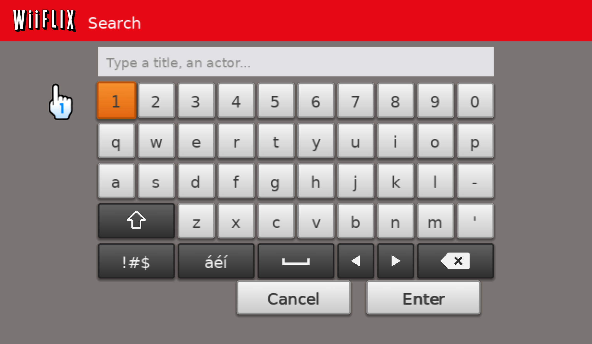
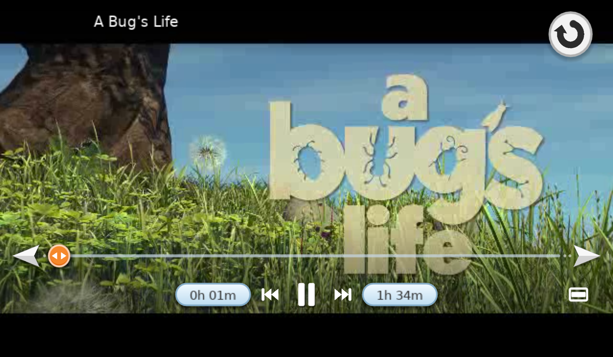

<p align="center">
  <br>
  <em>A recreation of Netflix for Wii using your Jellyfin movies and TV shows.</em>
</p>

---

**WiiFLIX** is a homebrew [Jellyfin](https://jellyfin.org) client for the Nintendo Wii, for **movies and TV shows** meant to replicate the original Wii Netflix app. It is a fork of [WiiFin](https://github.com/fabienmillet/WiiFin).

## 📸 Screenshots

<table>
  <tr>
    <td align="center"><br><sub>Launch screen</sub></td>
    <td align="center"><br><sub>Profiles</sub></td>
  </tr>
  <tr>
    <td align="center"><br><sub>Home screen</sub></td>
    <td align="center"><br><sub>Genre category selection</sub></td>
  </tr>
  <tr>
    <td align="center"><br><sub>TV show details</sub></td>
    <td align="center"><br><sub>Episode selection</sub></td>
  </tr>
  <tr>
    <td align="center"><br><sub>Search</sub></td>
    <td align="center"><br><sub>Playback</sub></td>
  </tr>
  <tr>
    <td align="center"><br><sub>Audio menu</sub></td>
    <td align="center"><br><sub>Subtitle menu</sub></td>
  </tr>
</table>

## ✨ Features

- **A line of covers, one row at a time**: Continue Watching, your **Instant Queue** (the titles you favorited in Jellyfin), then a row for every genre of your movies and TV shows. Point at a cover to enlarge it, click to open it; click the row's name to jump to any row from a list.
- **Details page**: Resume or Play, Play from beginning, Add to Queue, star rating, age rating, year and running time, the overview, cast, director and genres; a Subtitle | Audio button picks the tracks (and versions) from a list.
- **TV shows** open on the episode you are watching (or the next one), with **Select another episode**: every episode of the series in one long row, the ones started with a red bar.
- **Player**: a scrub bar with the server's thumbnails, ±10 s steps, resume where you stopped, skip intro / recap / credits, next and previous episode, audio and subtitle tracks, picture zoom.
- **Direct play** of what the Wii can decode (SD DivX/Xvid, H.264 up to 480p, MPEG-1/2, VP8); the server converts the rest. See [DIRECT_PLAY.md](DIRECT_PLAY.md).
- **Sign in** with your username and password, with **Quick Connect**, or by finding the server on your network. Several **profiles** (accounts and servers).
- **Search** across your movies, series and episodes.
- The **Wii's languages** (English and nine translations), the **Wii Remote** (pointer or D-pad), **Classic Controller**, **GameCube controller**, and the Wii U GamePad in a Virtual Console inject.

## 📦 Install

You need a Wii (or a Wii U's vWii) with the [Homebrew Channel](https://wiibrew.org/wiki/Homebrew_Channel), an SD card, and a Jellyfin server the Wii can reach on your network.

Get the files from the [releases](https://github.com/ArthurDickerson/WiiFlix/releases):

- **Homebrew Channel**: unzip `WiiFlix-hbc.zip` at the root of your SD card. It holds `apps/WiiFlix/` (the app, its icon, and fonts for Chinese and Korean). Start **WiiFLIX** from the Homebrew Channel.
- **Wii Menu channel** (optional): install `WiiFlix.wad` with a WAD manager. It is fakesigned, so the Wii must accept that (a patched IOS, as WAD managers set up). It installs as its own channel, *WiiFLIX* (title `WFLX`), beside WiiFin if you have it. Installing WADs always carries some risk: the Homebrew Channel is the safe way. For Chinese or Korean, also copy `apps/WiiFlix/fonts/` from the zip to the SD card.
- **Dolphin**: open `WiiFlix.dol`.

Then sign in to your Jellyfin server. WiiFLIX keeps its settings, profiles and log (`wiifin.log`) in `SD:/apps/WiiFlix/`.

## 🎮 Controls

With the Wii Remote: point and press **A** on anything on the screen, or use the buttons below. Buttons on screen grow and turn orange when chosen.

**Home (the cover line)**

| Button | Action |
|---|---|
| D-pad Left / Right | Previous / next cover (hold to keep going) |
| D-pad Up / Down | Previous / next row (the ▼▲ buttons, top right) |
| **−** / **+** | A screenful of covers back / on |
| **A** | Open the cover in focus |
| **1** | Search |
| **2** | WiiFLIX menu: back to WiiFLIX, switch profile, the main menu (Sign Out is there) |
| Pointer | Hover to enlarge a cover; drag the scrub bar's knob to race through a long row; click the row's name for the list of rows |

**Details page**

| Button | Action |
|---|---|
| D-pad | Move between the buttons, the Subtitle \| Audio button and the back button |
| **A** | Press the button in focus |
| **B** | Back |
| **+** | Mark watched / not watched |
| **−** | Read the whole overview |

**Select another episode**

| Button | Action |
|---|---|
| D-pad Left / Right | Previous / next episode |
| **−** / **+** | A screenful of episodes back / on |
| **A** | Show that episode on the show's page |
| **B** | Back |

**Player**

| Button | Action |
|---|---|
| **A** | Pause / play (or the button under the pointer) |
| D-pad Left / Right | Back / on 10 seconds (hold to go faster) |
| D-pad Up / Down | Volume |
| **−** / **+** | Previous / next episode |
| **1** / **2** | Audio track / subtitles |
| **B** | Back to the details page |
| Pointer | Click the bar to jump there; the arrows step 10 s; the speaker and caption buttons (bottom left) pick the audio track and subtitles, the screen (bottom right) zooms |

**HOME** opens the Wii's HOME Menu anywhere.

## ⚠️ Status

WiiFLIX is **experimental**: it works, but expect rough edges.

- Direct play covers SD videos only; HD files are converted by the server. Stereo sound.
- Picture subtitles (PGS, VobSub) are burned in by the server.
- Music, photos and books are not supported (WiiFLIX is for movies and TV shows).

## 🛠️ Building

You need [devkitPro](https://devkitpro.org) (devkitPPC, libogc, the `wii-dev` portlibs). On Linux with `pacman` or `dkp-pacman`, `./setup.sh` installs everything, builds GRRLIB and mbedTLS, and installs libWiiPy (for the WAD) in `tools/.venv`. On Windows, build in WSL.

```bash
./build.sh                  # WiiFlix.dol
./build.sh wad              # WiiFlix.wad, the Wii Menu channel
tools/make_release.sh       # WiiFlix-hbc.zip, the Homebrew Channel package
```

The version is in `source/version.h`. The channel's icon, banner and name come from `tools/wad/banner.bnr`, built from `assets/channel_icon.png` and `assets/channel_banner.png` by `tools/wad/make_banner.py`.

Playback needs MPlayer CE as `libmplayer.a`: a prebuilt one is in `libs/mplayer-ce-build` (see [MPLAYER_CE_BUILD.md](MPLAYER_CE_BUILD.md) to rebuild it).

## 🙏 Credits

WiiFLIX is built on [WiiFin](https://github.com/fabienmillet/WiiFin) by fabienmillet and its contributors, which does all the hard work: the Jellyfin client, playback through MPlayer CE, HTTPS, sign-in and profiles. Thanks to the [devkitPro](https://devkitpro.org), [GRRLIB](https://github.com/GRRLIB/GRRLIB), [MPlayer CE](https://github.com/extremscorner/mplayer-ce) and [Jellyfin](https://jellyfin.org) projects.

WiiFLIX is a fan project. It is not affiliated with or endorsed by Netflix, Nintendo or Jellyfin.

## 📜 License

GPL-3.0, like WiiFin: see [LICENSE](LICENSE).
